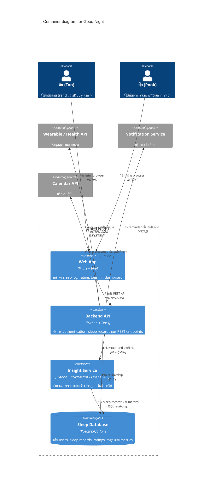

# C4 Level 2 — Container Diagram: Good Night

เอกสารนี้ซูมจาก system context เข้ามาที่ container หลักของ Good Night โดยระบุ technology label และ protocol ของทุกความสัมพันธ์ที่สำคัญ

## Diagram

## Container responsibilities

| Container | Responsibility | Boundary ที่ต้องรักษา |
| --- | --- | --- |
| Web App | รับ input และแสดงผล sleep log, rating, tags และ dashboard | ไม่เข้าถึงฐานข้อมูลโดยตรง |
| Backend API | authentication, authorization, validation และ business rules | เป็นจุดเดียวที่รับคำขอจาก Web App |
| Insight Service | คำนวณ trend และสร้างคำอธิบายจากข้อมูลที่ผ่านการอนุญาต | อ่านข้อมูลตามขอบเขต ไม่เขียนข้อมูลผู้ใช้โดยตรง |
| Sleep Database | เก็บข้อมูลผู้ใช้และ sleep records | แยกสิทธิ์การเข้าถึงและรักษา data integrity |

การกำหนด container แบบนี้ทำให้ core flow ยังเข้าใจง่ายสำหรับทีมเล็ก แต่มี service boundary สำหรับ analytics ซึ่งสามารถแยก deploy หรือ scale เพิ่มได้เมื่อมีหลักฐานจาก NFR และภาระงานจริง

