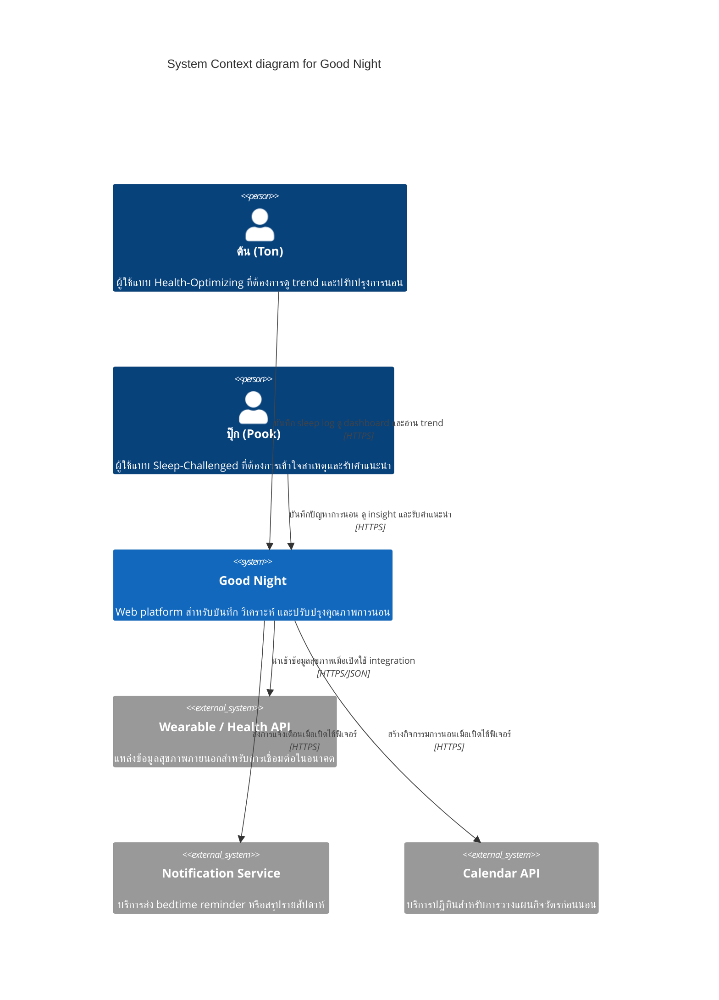

# C4 Level 1 — System Context: Good Night

เอกสารนี้แสดงขอบเขตของระบบ Good Night ในระดับระบบ (system context) ตามเกณฑ์ Lab 5 โดยเน้นผู้ใช้หลัก ระบบภายนอก และการไหลของข้อมูลที่จำเป็นต่อ Sleep Tracking & Optimization

## Scope

- ผู้ใช้หลักคือ ต้น (Health-Optimizing) และปุ๊ก (Sleep-Challenged)
- ความสามารถหลักในภาคเรียนนี้คือ manual sleep log, quality rating, behavioral tags และ dashboard/trend
- การ sync จาก wearable แบบ real-time เป็น future integration และไม่อยู่ใน core scope ของเทอมนี้

## Diagram

## Context decisions

Good Night เป็นระบบหลักที่ควบคุมข้อมูลการนอนของผู้ใช้และเป็นเจ้าของ user flow ส่วนระบบภายนอกเป็น integration boundary ไม่ใช่แหล่งตัดสินใจแทนระบบหลัก การแยก boundary นี้ช่วยให้ทีมพัฒนา core manual logging ได้ก่อน โดยยังรองรับการต่อยอด health data, notification และ calendar ในภายหลัง

