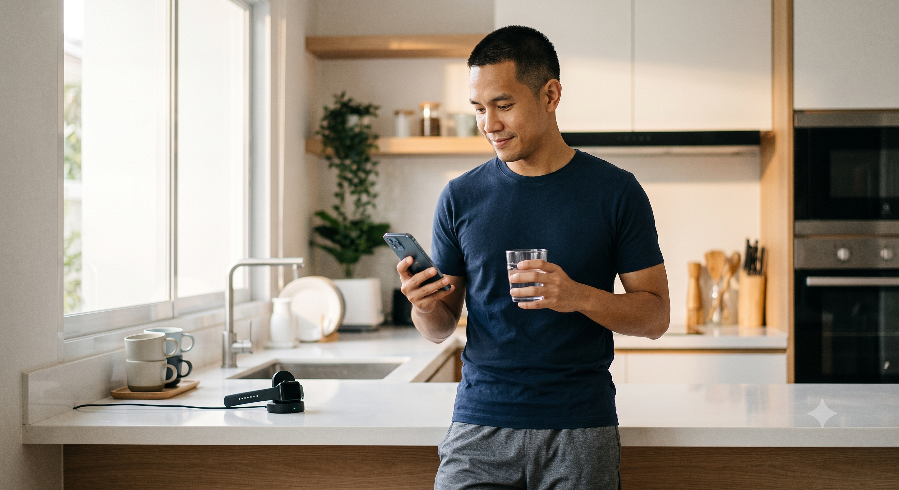

# User Persona: Health-Optimizing User

## Quantified Self Dashboard — Sleep Tracker

### คุณปณิธาน "ต้น" วงศ์สุวรรณ
**(Panitan "Ton" Wongsuwan)**

> "ผมไม่ได้มีปัญหานอนไม่หลับ แต่ผมอยากรู้ว่าสิ่งที่ผมทำอยู่ทุกวัน มันทำให้การนอนของผม 'ดีขึ้น' จริงไหม — ถ้าผมวัดไม่ได้ ผมก็ปรับปรุงมันไม่ได้"
>
> — ปณิธาน "ต้น" วงศ์สุวรรณ

---

## 1. Bio & Photo Description

| | |
|---|---|
| **ชื่อ** | ปณิธาน "ต้น" วงศ์สุวรรณ |
| **อายุ** | 34 ปี |
| **อาชีพ** | Product Manager ที่บริษัท Tech Startup ด้าน Fintech ในกรุงเทพฯ |
| **สถานะ** | แต่งงานแล้ว มีลูก 1 คน (อายุ 3 ขวบ) |

ต้นเป็นคนที่หลายคนมองว่า "ชีวิตดีอยู่แล้ว" — มีงานที่มั่นคง สุขภาพโดยรวมไม่มีปัญหาอะไรร้ายแรง นอนหลับได้ประมาณ 6-7 ชั่วโมงต่อคืน ไม่มีอาการนอนไม่หลับเรื้อรังหรือ sleep apnea แต่สิ่งที่ทำให้ต้นแตกต่างจากคนทั่วไปคือ mindset แบบ **"preventive optimization"** เขาเติบโตมาในครอบครัวที่พ่อเป็นโรคหัวใจตอนอายุ 50 กว่า ทำให้ต้นตระหนักตั้งแต่อายุ 30 ว่าสุขภาพคือการลงทุนระยะยาว ไม่ใช่เรื่องที่รอให้ป่วยก่อนแล้วค่อยแก้

เขาเริ่มออกกำลังกายสม่ำเสมอ ควบคุมอาหารคร่าวๆ และตอนนี้กำลังมองหาว่า "การนอน" ซึ่งเป็นตัวแปรสุดท้ายที่เขายังไม่เคยจัดการอย่างเป็นระบบ จะช่วยเพิ่ม performance ทั้งในชีวิตการทำงานและครอบครัวได้อย่างไร

---

## 2. Goals & Motivations

**เป้าหมายหลัก:** ต้นไม่ได้ต้องการ "แก้ปัญหา" การนอน เพราะเขาไม่ได้รู้สึกว่ามีปัญหาชัดเจน สิ่งที่เขาต้องการคือ **"การมองเห็นสิ่งที่มองไม่เห็น"** — เขาอยากรู้ว่าคุณภาพการนอนที่ดูปกติของเขาจริงๆ แล้วดีแค่ไหน มี pattern อะไรที่เขาไม่เคยสังเกต และสิ่งเล็กๆ น้อยๆ ในชีวิตประจำวัน (กาแฟตอนบ่าย, ออกกำลังกายตอนเย็น, เวลาดูมือถือก่อนนอน) ส่งผลต่อการนอนของเขาอย่างไร

แรงขับเคลื่อนที่แท้จริงของต้นคือ **"data-driven self-improvement"** เขาเชื่อในหลักการที่ว่า *"you can't improve what you don't measure"* เขาสนุกกับการเห็นกราฟแนวโน้ม การเชื่อมโยงข้อมูลข้ามมิติ (เช่น ความเครียดจากงาน x คุณภาพการนอน x พลังงานวันถัดไป) และรู้สึกภูมิใจเมื่อเห็นตัวเลขค่อยๆ ดีขึ้นจากการปรับพฤติกรรมเล็กๆ

ในเชิงลึก ต้นต้องการความรู้สึกว่าตัวเองกำลัง **"ควบคุมอนาคตสุขภาพของตัวเอง"** ได้ — เขาไม่อยากรอให้ร่างกายส่งสัญญาณเตือนแบบพ่อของเขา เขาอยากเป็นฝ่ายรุกในการดูแลสุขภาพ ไม่ใช่ฝ่ายตั้งรับ

---

## 3. Frustrations & Pain Points

แม้จะไม่มีปัญหาการนอนแบบเฉียบพลัน แต่ต้นมีความหงุดหงิดที่ละเอียดอ่อนกว่านั้น:

**"ข้อมูลเยอะ แต่ไม่มีความหมาย"**
ต้นเคยลองใช้ sleep tracker มาแล้วหลายตัว แต่ส่วนใหญ่ให้แค่ตัวเลข (เช่น "คุณนอน 6 ชม. 42 นาที") โดยไม่บอกว่า "แล้วไง?" เขารู้สึกว่า dashboard ส่วนใหญ่เป็นแค่ data dump ไม่ใช่ insight ที่นำไปปฏิบัติต่อได้จริง

**"ไม่รู้ว่าอะไรคือ 'ปกติ' สำหรับตัวเอง"**
เพราะต้นไม่ได้มีปัญหาชัดเจน เขาจึงหาความสำคัญของข้อมูลได้ยาก ตัวเลข Sleep Score 78 วันนี้ดีหรือแย่? เขาไม่มี baseline ส่วนตัวที่ชัดเจน และแอปส่วนใหญ่ก็เทียบเขากับค่าเฉลี่ยทั่วไปที่ไม่ personalized พอ

**"คำแนะนำทั่วไปเกินไป"**
เขาเบื่อคำแนะนำแบบ generic เช่น "ควรนอน 8 ชั่วโมง" หรือ "หลีกเลี่ยงหน้าจอก่อนนอน" เพราะเขารู้อยู่แล้ว สิ่งที่เขาอยากได้คือคำแนะนำที่เชื่อมโยงกับ pattern ของเขาโดยเฉพาะ เช่น *"สัปดาห์ที่คุณออกกำลังกายตอนเย็นหลัง 19:00 REM sleep ของคุณลดลง 15%"*

**"เวลาที่จำกัดจากการมีลูกเล็ก"**
ในฐานะพ่อลูกอ่อน เวลาของต้นถูกแบ่งไปกับความรับผิดชอบครอบครัว เขาไม่มีเวลานั่งวิเคราะห์ dashboard ที่ซับซ้อน เขาต้องการข้อมูลที่ **"เข้าใจได้ในเวลา 30 วินาที"** ตอนดื่มกาแฟตอนเช้า

**"ความกังวลเรื่อง privacy"**
เพราะทำงานสาย Fintech ต้นมีความอ่อนไหวต่อเรื่องข้อมูลส่วนตัว เขากังวลว่าข้อมูลสุขภาพที่ sensitive จะถูกนำไปใช้อย่างไร ใครเห็นข้อมูลบ้าง และแอปมีมาตรฐานความปลอดภัยแค่ไหน

---

## 4. Tech-savviness & Habits

ต้นเป็น **early-to-mainstream adopter** — ไม่ใช่คนที่ต้องเป็นคนแรกที่ใช้ทุกเทคโนโลยีใหม่ แต่พร้อมลองผลิตภัณฑ์ใหม่ทันทีที่มี proof of concept หรือ social proof ที่น่าเชื่อถือ (รีวิวจากคนในวงการเทค, Reddit, หรือเพื่อนร่วมงานสาย product)

### 📱 อุปกรณ์และแอปที่ใช้เป็นประจำ

- **Apple Watch / Garmin** — ใส่ตลอดเวลารวมถึงตอนนอน เพื่อ track HRV, sleep stages, workout
- **Notion** — ใช้จัดการทั้งงานและ personal tracking (มี database ส่วนตัวสำหรับ track นิสัยต่างๆ)
- **Oura Ring** เคยลองใช้ช่วงสั้นๆ แต่เลิกเพราะราคา subscription สูงเทียบกับ value ที่ได้
- **MyFitnessPal** สำหรับ track อาหารบ้างเป็นบางช่วง
- **Strava** สำหรับวิ่งและปั่นจักรยานสัปดาห์ละ 3-4 ครั้ง

### ⚙️ พฤติกรรมการใช้เทคโนโลยี

- [x] สบายใจกับ interface ที่ซับซ้อนได้ระดับหนึ่ง (เพราะพื้นฐาน PM สาย tech) แต่จะเลิกใช้แอปทันทีถ้ารู้สึกว่า "onboarding นานเกินไป" หรือ "ต้องกรอกข้อมูล manual เยอะเกินไป"
- [x] ชอบแอปที่ automate การเก็บข้อมูลให้มากที่สุด และเปิดใช้ integration ผ่าน Apple Health / Google Fit ทันทีถ้าทำได้
- [x] เปิดรับ AI-powered recommendations แต่มีความคาดหวังสูง — ถ้า AI แนะนำอะไรที่ดูเหมือนสุ่มหรือไม่มี logic ชัดเจนรองรับ (เช่นไม่มีปุ่ม "ทำไมถึงแนะนำแบบนี้") เขาจะสูญเสียความเชื่อถือในแอปทันที
- [x] ชอบ feature ที่ให้เขา "drill down" เข้าไปดู raw data ได้เองด้วยถ้าต้องการ ไม่ใช่แค่เชื่อ AI แบบ black box
- [x] เช็คแอปสุขภาพช่วงเช้าตอนดื่มกาแฟ (5-10 นาที) และอีกครั้งช่วงก่อนนอน (review วันที่ผ่านมา) — ไม่ใช่คนที่เปิดแอปทั้งวัน แต่ต้องการ "weekly/monthly trend" มากกว่า daily fluctuation เพราะเชื่อว่าการเปลี่ยนแปลงพฤติกรรมสุขภาพเห็นผลจริงในระยะกลาง-ยาว ไม่ใช่วันต่อวัน
