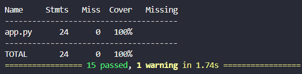
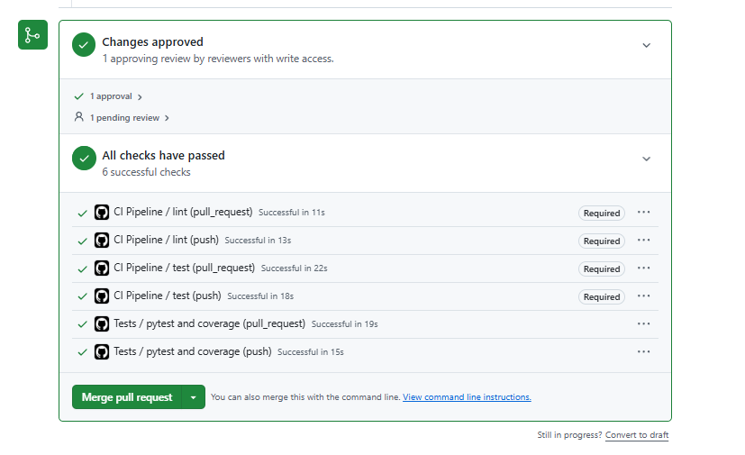

# Safety Net ของทีม Need to rest

## 1. ฟังก์ชันที่เลือกทดสอบ
- ฟังก์ชัน: `calculate_discount` — อยู่ไฟล์ `services/stats-service/app.py`; ไฟล์ entry point ตามชื่อใน rubric คือ `tests/test_unit.py` และมีชุด service tests เพิ่มใน `services/stats-service/tests/test_calculate_discount.py`
-เหตุผลที่เลือก: เป็น Pure Function ที่เป็น Core Business Logic สำหรับคำนวณส่วนลด ซึ่งมีผลกระทบต่อความถูกต้องทางการเงินของผู้ใช้งานโดยตรง และไม่มี External Dependencies (ไม่ต้องต่อ Database หรือ External API) เหมาะสมที่สุดสำหรับการทำ Safety Net และ Automated Unit Testing


## 2. เทสต์ที่เขียน (≥ 5 ตัว)
| # | ชื่อเทสต์ | ประเภท | ยืนยันอะไร |
|---|---|---|---|
| 1 | test_calculate_discount_standard_percentage | happy | ยอด 100 ลด 10% -> ยอดจ่ายสุทธิคือ 90 |
| 2 | test_calculate_discount_accepts_fractional_percentage | happy | รองรับเปอร์เซ็นต์ทศนิยม (ยอด 80 ลด 12.5% -> จ่าย 70) |
| 3 | test_calculate_discount_keeps_amount_when_percentage_is_zero | edge | ยอดเงินเมื่อส่วนลด 0% จะเท่าเดิมไม่ถูกหัก (1234.56 -> 1234.56) |
| 4 | test_calculate_discount_zero_amount_at_full_percentage_is_zero | edge | ลดเต็มจำนวน 100% ยอดสุทธิต้องเป็น 0 |
| 5 | test_calculate_discount_large_finite_amount_stays_finite | edge | ยอดเงินจำนวนมหาศาล (1,000,000,000 ลด 25% -> 750,000,000) คำนวณได้ถูกต้อง ไม่เกิด overflow |
| 6 | test_calculate_discount_rejects_negative_amount | error | ยอดเงินติดลบ (-1) ต้อง raise ValueError ("non-negative") |
| 7 | test_calculate_discount_rejects_non_finite_percentage | error | เปอร์เซ็นต์เป็น NaN หรืออยู่นอกช่วง 0-100 ต้อง raise ValueError |
| 8 | test_calculate_discount_rejects_non_finite_amount | error | ยอดเงินที่เป็น NaN/Infinity ต้อง raise ValueError ("finite") |

## 3. Coverage (วางผลลัพธ์จริงจากเครื่องตัวเอง)

ตีความ: ภาพ coverage/result ด้านบนเป็นหลักฐานจากรอบทดสอบเดิมที่แสดงในภาพ (15 tests) และครอบคลุม `calculate_discount` ณ เวลาที่บันทึกภาพ ไม่ใช่ผลนับของ test suite ล่าสุดหลังเพิ่มไฟล์ตามชื่อ rubric
ส่วนที่ยังไม่ครอบคลุม + เหตุผลที่ยอมรับความเสี่ยง: ไม่มีในฟังก์ชันที่วัดจาก run ในภาพ (Miss = 0 บรรทัด)

### ผลตรวจซ้ำในเครื่อง (2026-10-19)

รันคำสั่งจาก repository root ด้วย virtual environment ของงาน:

```powershell
python -m pytest -q --cov=app --cov=src.fizzbuzz --cov-branch --cov-report=term-missing --cov-fail-under=90
```

ผลล่าสุด: **41 passed**, `services/stats-service/app.py` และ `src/fizzbuzz.py` ได้ statement/branch coverage **100%** (Miss = 0); มี Starlette deprecation warning จาก dependency แต่ไม่มี test ล้มเหลว

## 4. CI block อะไรบ้าง
- `lint` (Ruff): ตรวจรูปแบบและปัญหาที่ linter ตรวจพบ
- `test` (pytest): รัน tests พร้อม coverage threshold ที่กำหนดใน workflow
- `build` (Docker): สร้าง image ของ stats service เพื่อเช็กว่า Dockerfile build ได้
- Workflow checks แสดงผล pass/fail ใน GitHub Actions แต่ยัง **ยืนยันไม่ได้** ว่า branch protection/ruleset ของ `main` ตั้ง checks เหล่านี้เป็น required หรือ block merge จริง
- ภาพ `result.png` เป็นหลักฐานผล workflow เท่านั้น ไม่ใช่ภาพหน้า Settings ที่ยืนยัน branch protection หรือข้อความ “Merging is blocked”


## 5. บทเรียนที่ได้
-เรียนรู้เรื่องฟังก์ชั่น และผลกระทบของมัน หากเกิดข้อผิดพลาดขึ้นมา

-ได้ศึกษาแนวทางตั้งค่า Branch Protection และ Rulesets เพื่อบังคับใช้ CI ก่อน merge; สถานะการตั้งค่าจริงของ repository ต้องให้ผู้มีสิทธิ์ตรวจยืนยันเพิ่มเติม

-ได้ฝึกแก้ไขปัญหาและการจัดการ Import รวมถึงการเขียนเทสต์ครอบคลุมทั้ง Boundary และ Error Handling
